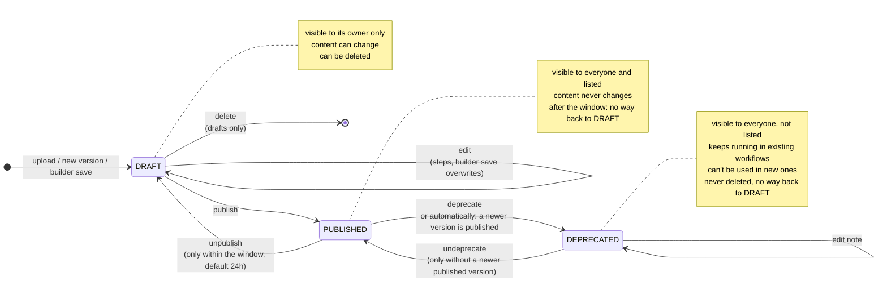
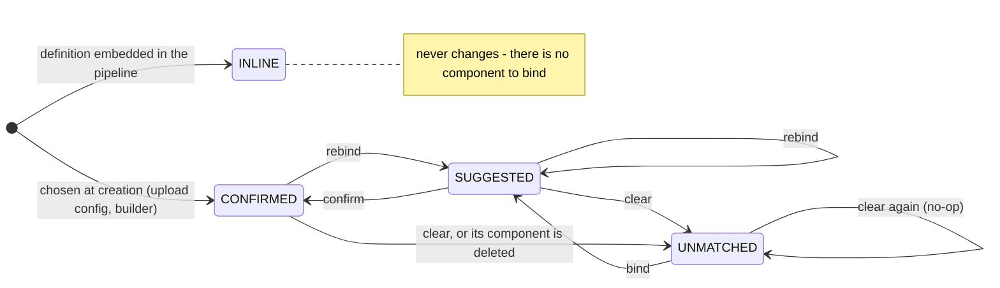

# Status Lifecycle

Which states a component version (tool or workflow) can be in, which transitions between them are allowed, and why. A published version is a promise to others: they may view, download, nest or cite it. So it can only be taken back for a short time after it first went public. After that it stays public, and is at most deprecated.

The rules live in `app/domain/composite/lifecycle.py`. It is the only code that writes `Component.status`, and it does so through the transition table `COMPONENT_TRANSITIONS`. The services add the conditions that need more context (other versions, workflows above, the clock).

## States and transitions

| State | Who sees it | Listed (browse, search, builder palette) | Content | Deletable |
|---|---|---|---|---|
| `draft` | owner only | no | changes in place | yes |
| `published` | everyone | yes | fixed | no |
| `deprecated` | everyone | no | fixed | no |

`PUBLIC_STATUSES` = {published, deprecated} decides who can read a version. `LISTED_STATUSES` = {published} decides what is offered for new use. A draft is always checked with `== DRAFT`, never with `!= PUBLISHED`: otherwise a deprecated version would be taken for a draft.

## Conditions and side effects

The diagram shows which transitions exist. Most of them have further conditions. A refused transition returns **409**, with a message that says why.

| Transition | Also refused when … | Side effect |
|---|---|---|
| **publish** | a newer version of the lineage is already published. For a workflow, also when a step isn't confirmed, a step runs another user's draft, or a direct step runs a deprecated version. | Older published versions of the lineage become **deprecated** ("Superseded by vN"). The owner's own draft components below a workflow are published along, if opted into (`publishComponents`). |
| **unpublish** | the window has closed. Other users' public workflows run the version. The owner's own public workflows run it and are deprecated, or past their own window. | `first_published_at` is cleared: the version counts as never published, its steps are editable again, and its next publish starts a new window. The owner's own public workflows above it, still within their window, become drafts along with it, if opted into (`unpublishParents`). |
| **deprecate** | – | Optional note, shown to everyone who opens or runs the version. |
| **undeprecate** | a newer version of the lineage is published. | – |
| **delete** | the version isn't a draft. A public workflow runs it (only possible with data from before these rules). | Steps that ran it become `unmatched`. A lineage's favorites go with its last version. |

**Deliberately missing:**
- `deprecated → draft`;
- deleting a `published` version;
- deleting a `deprecated` version.

Once its window has closed, a version stays public for good.

**Rolling back a bad v2:** deprecate v2, then undeprecate v1. Within v2's window, unpublishing v2 works too.

## The unpublish window

`UNPUBLISH_WINDOW_SECONDS` in `.env` (default `86400` = 24 hours). It counts from `first_published_at`, which `mark_published` sets on a version's first publish. It exists for one case: undoing an accidental publish. After it, nobody can know who already uses or cites the version, so it is only ever deprecated. That is the same reasoning as npm's unpublish policy, "yanking" on crates.io and PyPI, and FAIR principle A2 (metadata stays reachable even when the data isn't).

The detail DTO carries `unpublishableUntil` while the window is open. The publish dialog states the window length (`PublishImpactDto.unpublishWindowSeconds`) before anything is published.

## How the API offers the transitions

Every transition is a command in `COMPONENT_COMMANDS` (`app/application/service/components_service.py`), dispatched through `POST /components/{id}/commands`. Each command answers two different questions:

- **`allowed`: who may run it.** For these commands, the owner. Refused with **403**.
- **`available`: whether it applies to the version's current state.** For example, unpublish only within the window, and publish/undeprecate only without a newer published version. This only decides whether the HATEOAS link is offered, so the frontend shows no button where nothing can be done. If the command is sent anyway, the service refuses it with a **409** that says why (e.g. "published too long ago to be unpublished – deprecate it instead").

Delete is not a command but `DELETE /components/{id}`. Its `delete` link appears on drafts only.

## Step match status

A workflow step has a lifecycle of its own (`STEP_TRANSITIONS`), independent of the component's status:

A workflow can only be published once every step is `confirmed` or `inline`. Steps only change while the workflow is a draft. A builder workflow's steps only change on its canvas.
