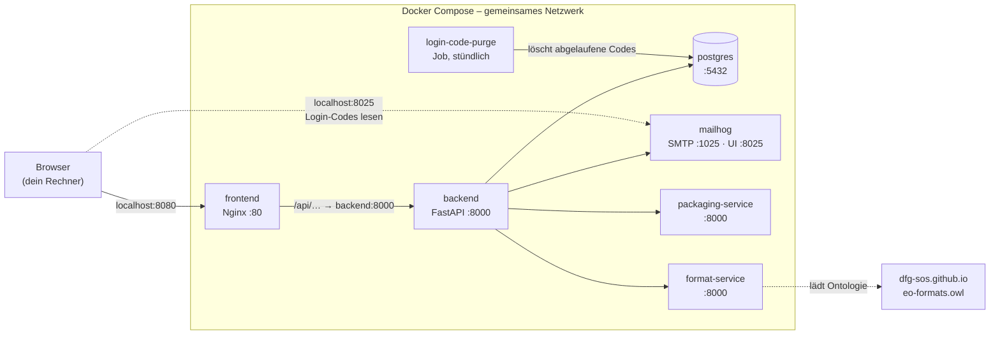
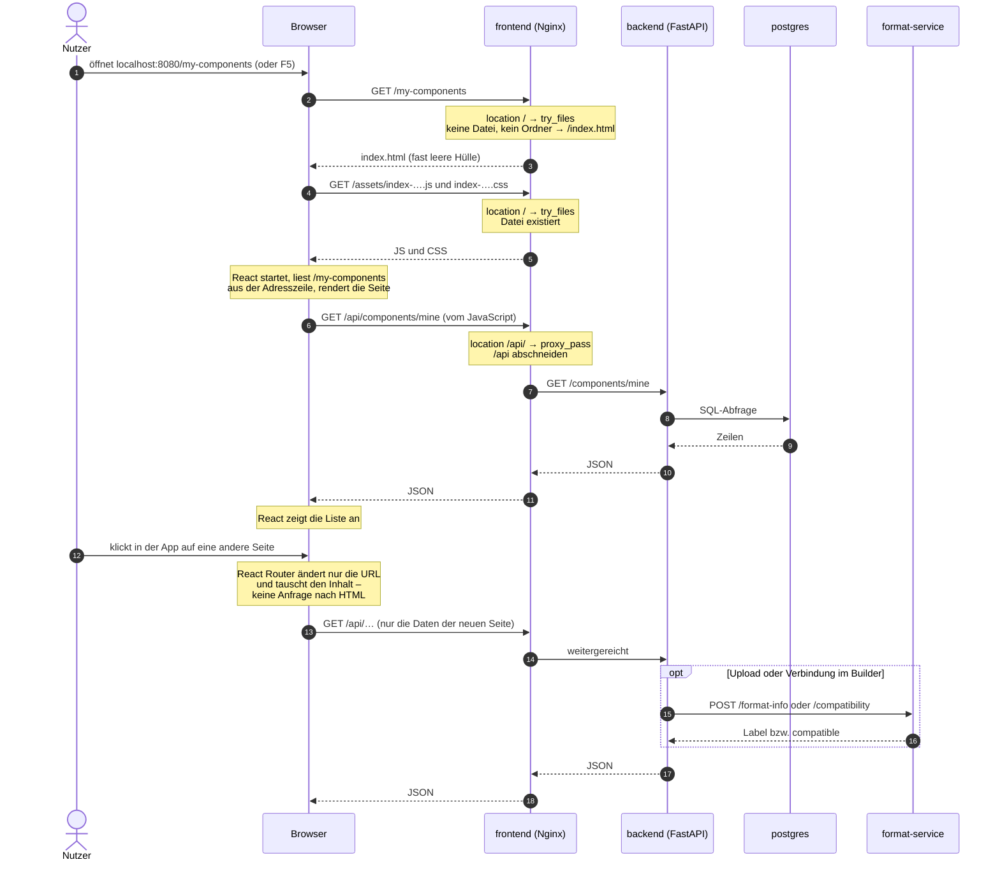

# Deployment mit Docker Compose

Diese Datei erklärt, wie die ganze Anwendung in Containern läuft: was Docker-Begriffe bedeuten, was die Dateien im Repo tun, wozu Nginx gebraucht wird und was bei einer Anfrage aus dem Browser passiert. Sie fasst Erklärungen zusammen, die beim Aufbau des Setups entstanden sind.

Die beteiligten Dateien:

| Datei | Inhalt |
|---|---|
| `docker-compose.yml` (Repo-Root) | welche Container laufen und wie sie verbunden sind |
| `Makefile` (Repo-Root) | Kurzbefehle `make docker-up`, `docker-down`, `docker-infra`, `docker-logs` |
| `backend-python/Dockerfile`, `.dockerignore` | Bauanleitung für das Backend-Image |
| `frontend/Dockerfile`, `.dockerignore` | Bauanleitung für das Frontend-Image |
| `frontend/nginx.conf` | Konfiguration des Webservers im Frontend-Container |
| `automated-packaging/Dockerfile` | Bauanleitung für den Packaging-Service |

---

## 1. Die Befehle

| Befehl | Was passiert |
|---|---|
| `make docker-up` | Startet die ganze App und baut geänderte Images neu (`docker compose up -d --build`). Danach: App auf http://localhost:8080, Login-Codes in Mailhog auf http://localhost:8025. |
| `make docker-down` | Stoppt und entfernt alle Container. Die Daten der Datenbank bleiben erhalten (Volume). |
| `make docker-infra` | Startet nur die Infrastruktur: Postgres, Mailhog, Packaging- und Format-Service. Für die Entwicklung, siehe Abschnitt 9. |
| `make docker-logs` | Zeigt die Logs aller Container fortlaufend. `make docker-logs s=backend` zeigt nur einen. |

Zum Nachschauen:

```bash
docker compose ps                  # welche Container laufen, sind sie "healthy"?
docker compose exec backend sh     # Shell *im* Backend-Container öffnen
docker compose exec backend env    # Umgebungsvariablen des Backend-Containers
docker volume ls                   # Volumes, u. a. die Datenbank
```

Voraussetzung: `backend-python/.env` existiert (Kopie von `backend-python/.env.example` mit gesetztem `JWT_SECRET`).

---

## 2. Docker-Grundbegriffe

**Image:** ein eingefrorenes Paket mit allem, was ein Programm zum Laufen braucht: Grundsystem (ein schlankes Linux), Laufzeit (Python, Node), Bibliotheken und der eigene Code. Ein Image ändert sich nach dem Bauen nicht mehr.

**Container:** ein laufendes Exemplar eines Images. Aus einem Image kann man beliebig viele Container starten. Ein Container ist ein abgeschotteter Prozess mit eigenem Dateisystem und eigenem Netzwerk. Den Rechner, auf dem er läuft, sieht er nur dort, wo man es ausdrücklich erlaubt (Ports, Volumes).

**Dockerfile:** das Rezept, aus dem ein Image gebaut wird: „Nimm Python, kopiere diese Dateien hinein, installiere das, starte am Ende jenes.“

**docker-compose.yml:** beschreibt, welche Container zusammen laufen und wie sie verbunden sind. `docker compose up` startet alle in der richtigen Reihenfolge.

**Volume:** Speicher außerhalb des Containers. Container sind wegwerfbar: Was ein Container intern schreibt, ist weg, sobald er gelöscht wird. Die Datenbank schreibt deshalb in ein Volume, und ihre Daten überleben jedes `make docker-down`.

**Image oder Compose?** Das Dockerfile beschreibt das **Image**, also was im Paket steckt. Die Compose-Datei beschreibt, **wie ein Container daraus gestartet wird**: mit welchen Ports, Einstellungen und Volumes. Alles, was erst beim Start feststeht, gehört in die Compose-Datei.

---

## 3. Die Container im Überblick



| Service | Port außen:innen | Image | Aufgabe |
|---|---|---|---|
| `frontend` | 8080:80 | gebaut aus `frontend/` | Nginx: liefert die React-App aus, reicht `/api/` ans Backend weiter |
| `backend` | 8000:8000 | gebaut aus `backend-python/`, benannt `component-repository-backend` | FastAPI, migriert beim Start die DB, Swagger unter `/docs` |
| `postgres` | 5433:5432 | `postgres:16` | Datenbank |
| `mailhog` | 1025, 8025 | `mailhog/mailhog` | fängt Login-Mails ab, Web-UI auf 8025 |
| `packaging-service` | 8002:8000 | gebaut aus `automated-packaging/` | verpackt MoveApps-Repos als CWL-Tools |
| `format-service` | 8001:8000 | `ghcr.io/dfg-sos/file-format-service` | Format-Labels und Port-Kompatibilität |
| `login-code-purge` | – | dasselbe Image wie `backend` | geplanter Job: löscht stündlich abgelaufene Login-Codes (Abschnitt 10) |

---

## 4. Die Compose-Datei im Detail

### 4.1 Netzwerk: Container finden sich über ihren Namen

Compose steckt alle Services automatisch in ein gemeinsames, privates Netzwerk. Darin ist **jeder Service unter seinem Namen erreichbar**: `postgres`, `mailhog`, `backend`, `format-service`. Innerhalb dieses Netzes erreicht jeder Container jeden anderen auf jedem Port.

`localhost` heißt im Container immer „dieser Container selbst“. Deshalb kann das Backend im Container die Datenbank nicht unter `localhost` erreichen. Es braucht `postgres`.

### 4.2 Ports: `EXPOSE` gegenüber `ports`

**`EXPOSE 8000` im Dockerfile ist nur Dokumentation:** „Das Programm in diesem Image lauscht auf Port 8000.“ Technisch öffnet es nichts.

**`ports` in der Compose-Datei öffnet tatsächlich den Weg von deinem Rechner in den Container:**

```yaml
ports:
  - "8080:80"     # <Port auf deinem Rechner>:<Port im Container>
```

Der Außenport ist eine Eigenschaft des Rechners, nicht des Programms, deshalb steht er in der Compose-Datei. Beispiel Postgres: Im Container lauscht er immer auf 5432, außen nehmen wir 5433.

Für Verbindungen **zwischen** Containern braucht man `ports` nicht, das läuft über das interne Netz (4.1). `ports` ist nur die Tür nach außen:

| Service | wofür der Port nach außen offen ist |
|---|---|
| frontend `8080` | **nötig**: Das ist die App im Browser. |
| backend `8000` | für die App nicht nötig (Nginx geht intern), aber für Swagger unter `localhost:8000/docs` |
| postgres `5433` | für die Entwicklung: `make run` läuft außerhalb von Docker, dazu DB-Tools |
| mailhog `8025` | um Login-Codes im Browser zu lesen; `1025` für die Entwicklung |
| format `8001`, packaging `8002` | für die Entwicklung |

### 4.3 Konfiguration: `env_file` und `environment`

```yaml
  backend:
    env_file: ./backend-python/.env
    environment:
      DATABASE_HOST: postgres
      DATABASE_PORT: 5432
      SMTP_HOST: mailhog
      SMTP_PORT: 1025
      PACKAGING_SERVICE_URL: http://packaging-service:8000/api/v1
      FORMAT_SERVICE_URL: http://format-service:8000/api/v1
      CORS_ORIGIN: http://localhost:8080
```

**Zwei verschiedene Zeitpunkte:**
- **Build-Zeit:** `backend-python/.dockerignore` sorgt dafür, dass die Datei `.env` *nicht* ins Image kommt. Ein Image ist etwas Dauerhaftes, das man weitergeben kann. Secrets wie `JWT_SECRET` sollen nicht darin stecken.
- **Start-Zeit:** `env_file` liest die `.env` **auf deinem Rechner** und übergibt ihren Inhalt beim Start als Umgebungsvariablen an den Container. Die Datei selbst kommt dabei nicht in den Container.

**Reihenfolge:** Erst gilt alles aus `env_file`, dann überschreibt `environment:` einzelne Werte. Deine `.env` bleibt dabei unverändert und gilt weiter für `make run`.

| Variable | in `.env` (für `make run`) | im Container |
|---|---|---|
| `DATABASE_USER` | moveapps | moveapps (aus `.env`) |
| `DATABASE_HOST` | localhost | **postgres** |
| `DATABASE_PORT` | 5433 | **5432** |
| `CORS_ORIGIN` | http://localhost:5173 | **http://localhost:8080** |

**Warum wird der Port extra gesetzt, obwohl er beim Postgres-Service unter `ports:` steht?** Die beiden Angaben beantworten verschiedene Fragen:
- `ports: "5433:5432"` beim Postgres-Service: „Über welchen Port auf **deinem Rechner** kommt man hinein?“ Das ist eine Einstellung für Docker, das Backend erfährt davon nichts.
- `DATABASE_PORT` beim Backend: „Wohin soll sich **das Backend** verbinden?“ Die Antwort hängt davon ab, von wo aus verbunden wird: `make run` auf dem Mac geht durch die Außentür (`localhost:5433`), der Backend-Container spricht Postgres im internen Netz direkt an (`postgres:5432`).

(`SMTP_PORT` wird aus Symmetrie mitgesetzt. Mailhog nutzt innen und außen 1025, die Überschreibung ändert also nichts.)

**Wo stehen die Umgebungsvariablen im Container?** In keiner Datei, weder in einer `.env` noch in `.bashrc`. Umgebungsvariablen sind eine Eigenschaft eines **Prozesses**:
1. Compose baut beim Start aus `env_file` und `environment:` eine Liste `NAME=Wert`.
2. Docker speichert sie in der Konfiguration des Containers (sichtbar mit `docker inspect`, unter `Config.Env`).
3. Docker startet den Hauptprozess (`uvicorn` aus dem `CMD`) und übergibt ihm die Liste direkt. Eine Shell ist nicht beteiligt.

Ansehen kann man sie mit `docker compose exec backend env`. Unter Linux liegen sie für jeden Prozess in `/proc/<prozessnummer>/environ`.

Das Backend merkt keinen Unterschied. `pydantic-settings` in `backend-python/app/config.py` liest sowohl eine `.env`-Datei (lokal) als auch Umgebungsvariablen (Container). Sind beide vorhanden, gewinnen die Umgebungsvariablen.

**Das Prinzip dahinter:** Das Image enthält den Code, die Konfiguration kommt erst beim Start dazu. Dasselbe Image ließe sich mit einer anderen `.env` auf einem Server starten, ohne neu zu bauen.

### 4.4 Startreihenfolge: `depends_on` und `healthcheck`

Container starten parallel. Ohne Vorkehrung würde das Backend versuchen zu migrieren, während Postgres noch hochfährt.

- `healthcheck` beim Postgres-Service fragt regelmäßig mit `pg_isready`, ob die Datenbank bereit ist.
- `depends_on: postgres: condition: service_healthy` beim Backend lässt es erst starten, wenn das mit „ja“ beantwortet ist.
- Das Backend hat selbst einen Healthcheck auf `/health`. `docker compose ps` zeigt ihn als „(healthy)“.

`restart: unless-stopped` startet einen Container nach einem Absturz oder einem Docker-Neustart wieder, außer man hat ihn selbst gestoppt.

### 4.5 Volume für die Datenbank

```yaml
  postgres:
    volumes:
      - postgres_data:/var/lib/postgresql/data
volumes:
  postgres_data:
```

Postgres schreibt seine Daten im Container nach `/var/lib/postgresql/data`. Das Volume legt diesen Ordner nach außen. Compose nennt es `2026-ma-julius-arzberger_postgres_data` (Projektname plus Volumename).

Früher lagen Postgres und Mailhog in `backend-python/docker-compose.yml` mit dem Volume `backend-python_postgres_data`. Beim Umzug in die Root-Compose wurden die Daten in das neue Volume kopiert. Das alte Volume blieb als Backup stehen.

---

## 5. Das Backend-Image (`backend-python/Dockerfile`)

### 5.1 Build-Kontext: woher `COPY` kopiert

```yaml
  backend:
    build: ./backend-python
```

Die Kurzform setzt den **Build-Kontext**: den Ordner, den Docker beim Bauen an den Build-Prozess schickt. Ausführlich geschrieben:

```yaml
    build:
      context: ./backend-python
      dockerfile: Dockerfile    # Standard, relativ zum Kontext → backend-python/Dockerfile
```

- **Quellpfade** in `COPY` sind relativ zum Kontext. `COPY pyproject.toml ./` nimmt `backend-python/pyproject.toml`. Läge die Datei unter `backend-python/src/setup/`, hieße es `COPY src/setup/pyproject.toml ./`.
- **Zielpfade** sind relativ zum aktuellen `WORKDIR` im Image, hier `/app`.
- Außerhalb des Kontexts kann man nichts kopieren (`COPY ../openapi.json` geht nicht).
- `.dockerignore` filtert den Kontext. Was dort steht, kommt bei Docker gar nicht an.
- Dockerfile-Ort und Kontext sind zwei verschiedene Dinge. Mit `context: .` und `dockerfile: backend-python/Dockerfile` würden alle `COPY`-Pfade beim Repo-Root beginnen.

**`build:` und `image:`:** `build:` sagt Compose, dass es aus einem Ordner ein Image bauen soll. Dafür führt es das Dockerfile aus. `image:` gibt den Namen an:

| im Service steht | Bedeutung |
|---|---|
| `build:` und `image:` | Bauen und das Ergebnis so nennen. So macht es der `backend`-Service: `component-repository-backend`. |
| nur `image:` | Nichts bauen, das Image mit diesem Namen nehmen und es herunterladen, falls es lokal fehlt. So machen es `postgres`, `mailhog`, `format-service`, und mit `pull_policy: never` (nie herunterladen) auch `login-code-purge`. |
| nur `build:` | Bauen, Compose vergibt den Namen `<Projekt>-<Service>` selbst. So macht es `frontend`. |

### 5.2 Zeile für Zeile

```dockerfile
FROM python:3.12-slim
```
Ausgangspunkt: ein fertiges Image mit schlankem Linux und Python 3.12.

```dockerfile
COPY --from=ghcr.io/astral-sh/uv:0.12.18 /uv /usr/local/bin/
```
Holt das Programm `uv` (dasselbe wie lokal bei `make install`) aus dessen offiziellem Image.

```dockerfile
ENV PYTHONDONTWRITEBYTECODE=1 PYTHONUNBUFFERED=1 UV_LINK_MODE=copy \
    UV_PROJECT_ENVIRONMENT=/opt/venv PATH="/opt/venv/bin:${PATH}"
```
Umgebungsvariablen im Image:
- `PYTHONUNBUFFERED`: Logs erscheinen sofort.
- `UV_PROJECT_ENVIRONMENT`: Die virtuelle Umgebung liegt unter `/opt/venv`.
- `PATH`: Befehle wie `uvicorn` werden dort gefunden.

```dockerfile
WORKDIR /app
COPY pyproject.toml uv.lock ./
RUN uv sync --frozen --no-dev --no-install-project
```
Installiert **nur die Abhängigkeiten**, exakt nach `uv.lock` (`--frozen`) und ohne Test-Tools (`--no-dev`).

**Warum erst die Abhängigkeitslisten, dann der Code?** Docker baut Schicht für Schicht und merkt sich jede Schicht im Cache. Ändert sich nur der Code, aber nicht `uv.lock`, kommt die Installationsschicht aus dem Cache. Ein Rebuild dauert dann Sekunden statt Minuten.

```dockerfile
COPY alembic.ini ./
COPY alembic ./alembic
COPY config ./config
COPY app ./app
```
Der eigentliche Code:
- Alembic für die Migrationen, die das Backend beim Start ausführt (`AUTO_MIGRATE`). Es liest `alembic.ini` aus dem Arbeitsverzeichnis.
- `config/domains.json` wird zur Laufzeit gelesen.
- Im Image entsteht dieselbe Struktur wie in `backend-python/`, nur unter `/app`.

Nicht hinein kommen laut `.dockerignore`: Tests, `tmp/`, das lokale `.venv`, `.env`.

```dockerfile
RUN useradd --create-home --uid 1000 api
USER api
```
Das Programm läuft als normaler Nutzer statt als `root`. Hätte die App eine Lücke, hätte ein Angreifer im Container weniger Rechte.

```dockerfile
EXPOSE 8000
CMD ["uvicorn", "app.main:app", "--host", "0.0.0.0", "--port", "8000"]
```
Der Startbefehl, wie `make run`, nur ohne `--reload`. `--host 0.0.0.0` heißt „nimm Verbindungen von überall an“. Mit dem lokalen Standard `127.0.0.1` wäre uvicorn nur innerhalb des eigenen Containers erreichbar.

---

## 6. Das Frontend-Image (`frontend/Dockerfile`)

### 6.1 Zwei Stufen (Multi-Stage-Build)

```dockerfile
FROM node:22-alpine AS build
WORKDIR /app
COPY package.json package-lock.json ./
RUN npm ci
COPY . .
ARG VITE_API_BASE_URL=/api
ENV VITE_API_BASE_URL=${VITE_API_BASE_URL}
RUN npm run build
```
**Stufe 1, die Werkstatt:** Node.js installiert die Pakete, kopiert den Code und baut ihn mit `npm run build` (`tsc -b` und `vite build`). Das Ergebnis ist der Ordner `dist/`.

`VITE_API_BASE_URL` wird beim Build **fest ins JavaScript geschrieben**. Vite ersetzt `import.meta.env.VITE_API_BASE_URL` durch den Text `"/api"`. Warum `/api`, steht in Abschnitt 7.

```dockerfile
FROM nginx:1.29-alpine
COPY nginx.conf /etc/nginx/conf.d/default.conf
COPY --from=build /app/dist /usr/share/nginx/html
EXPOSE 80
```
**Stufe 2, das eigentliche Image:** Es startet frisch von Nginx und übernimmt aus der Werkstatt **nur** den Ordner `dist/`. Node, `node_modules` und der Quellcode landen nicht im Endprodukt, das Image bleibt klein.

### 6.2 Was eine gebaute React-App ist

Nach dem Build liegt im Container nur das hier:

```
/usr/share/nginx/html/
├── index.html
├── assets/index-<hash>.js     ← die komplette App (alle Seiten, Routing, React selbst)
├── assets/index-<hash>.css
├── favicon.svg
└── icons/…
```

Die `index.html` ist fast leer:

```html
<head>
  <script type="module" src="/assets/index-<hash>.js"></script>
  <link rel="stylesheet" href="/assets/index-<hash>.css">
</head>
<body>
  <div id="root"></div>
</body>
```

Eine gebaute React-App ist also eine Single Page Application (SPA): **eine** HTML-Hülle plus ein JavaScript-Bundle plus CSS und Bilder. Das JavaScript baut die Seiten im Browser in das leere `<div id="root">` hinein. Die Daten holt es per API vom Backend.

**Es gibt keine Datei pro Seite.** `/my-components` oder `/browse` sind Routen aus `frontend/src/App.tsx`, also Regeln im JavaScript:

```tsx
<Route path="/my-components" element={<MyComponentsPage />} />
```

„Wenn in der Adresszeile `/my-components` steht, zeige `MyComponentsPage`.“ Diese Adresse wertet die App selbst aus, sie entspricht keiner Datei auf dem Server.

---

## 7. Nginx

### 7.1 Was Nginx ist

Nginx („Engine-X“) ist ein Webserver: ein schnelles, schlankes Programm, das HTTP-Anfragen annimmt und beantwortet. Im Frontend-Container lauscht es auf Port 80, nach außen gemappt auf 8080.

### 7.2 Zwei Aufgaben

**Aufgabe 1, unverzichtbar: die Frontend-Dateien ausliefern.** Nach dem Build gibt es nur noch Dateien (6.2). Irgendein Programm muss sie an den Browser schicken. Beim Entwickeln macht das der Vite-Dev-Server (`npm run dev`), der aber ein Entwicklungswerkzeug und nicht für den Dauerbetrieb gedacht ist.

**Aufgabe 2, gewählt: `/api/` an das Backend weiterreichen.** Wichtig dafür: **Das Frontend-JavaScript läuft nicht im Container, sondern im Browser.** Nginx schickt die JS-Datei nur aus. Ruft das JavaScript das Backend auf, kommt die Anfrage von außerhalb von Docker. Damit gibt es zwei Probleme:
- Der Browser kennt die Container-Namen nicht. Mit `http://backend:8000` kann er nichts anfangen.
- **CORS:** Browser blockieren standardmäßig Anfragen von einer Adresse (`localhost:8080`) an eine andere (`localhost:8000`), außer der Server erlaubt es ausdrücklich.

Nginx löst beides: Der Browser spricht nur mit `localhost:8080`, und Nginx entscheidet anhand des Pfads, wer antwortet. Deshalb wird das Frontend mit `VITE_API_BASE_URL=/api` gebaut. Jede API-Anfrage geht relativ an die eigene Adresse.

**Geht es auch ohne Nginx?** Für Aufgabe 2 ja: Das Backend ist über `ports: "8000:8000"` ohnehin erreichbar. Man könnte das Frontend mit `VITE_API_BASE_URL=http://localhost:8000` bauen und dem Backend `CORS_ORIGIN=http://localhost:8080` geben. Aufgabe 1 verschwindet aber nicht, es braucht immer einen Webserver für die gebauten Dateien. Die Alternativen:

| Variante | Bewertung |
|---|---|
| **Nginx** (gewählt) | Standardlösung, sehr kleines Image, erledigt beide Aufgaben |
| FastAPI liefert `dist/` mit aus (`StaticFiles` + SPA-Rückfall) | ein Container weniger, aber das Frontend hängt fest am Backend-Image, und das Backend-Dockerfile müsste Node zum Bauen enthalten |
| Node-Container mit `vite preview` / `serve` | größer, `vite preview` ist laut Vite nicht für den Betrieb gedacht |
| Vite-Dev-Server im Container | nur für Entwicklung |

Vorteile des Weiterreichens gegenüber dem direkten Weg:
- **Kein CORS:** Für den Browser kommt alles von `localhost:8080`.
- **Das Image hängt an keiner Adresse:** Mit `/api` fragt der Browser immer dort, wo er die Seite herhat. Mit `http://localhost:8000` würde das Image auf einem Server den Rechner des Besuchers anfragen und müsste pro Umgebung neu gebaut werden.
- **Nur eine Tür nach außen:** Auf einem Server müsste nur Nginx öffentlich sein.

### 7.3 `nginx.conf` Zeile für Zeile

```nginx
server {
    listen 80;
    root /usr/share/nginx/html;
```
Nginx lauscht auf Port 80. `root` ist der Ordner, aus dem Dateien ausgeliefert werden, also der kopierte `dist/`-Ordner.

**Welcher Block greift?** Nginx wählt für jede Anfrage den `location`-Block mit dem längsten passenden Präfix. `/api/components` passt besser zu `location /api/` als zu `location /`.

#### `location /api/`: an das Backend weiterreichen

```nginx
    location /api/ {
        proxy_pass http://backend:8000/;
```
Alles unter `/api/` geht an den Backend-Container. Der abschließende `/` in `proxy_pass` schneidet `/api` ab: `localhost:8080/api/components` wird zu `backend:8000/components`. Nginx läuft im Compose-Netz und kennt deshalb den Namen `backend`.

```nginx
        proxy_set_header Host $host;
        proxy_set_header X-Forwarded-For $proxy_add_x_forwarded_for;
        proxy_set_header X-Forwarded-Proto $scheme;
```
Mit Nginx dazwischen gibt es zwei Verbindungen: Browser → Nginx und Nginx → Backend. Das Backend sieht nur die zweite, für das Backend ist Nginx der Absender. Diese Header geben die verlorenen Informationen als Vermerk mit:
- **`Host`:** unter welchem Namen die Seite aufgerufen wurde (`localhost` statt `backend:8000`). Wichtig, wenn ein Backend vollständige URLs baut.
- **`X-Forwarded-For`:** die echte IP des Browsers, etwa für Logs, Rate-Limits oder Sperrlisten.
- **`X-Forwarded-Proto`:** ob der Browser `http` oder `https` benutzt hat. Wichtig, wenn Nginx auf einem Server HTTPS annimmt und intern per HTTP weiterreicht.

Unser Backend wertet die Header derzeit nicht aus. Die HATEOAS-Links sind relative Pfade, und uvicorn vertraut `X-Forwarded-For` standardmäßig nur von `127.0.0.1`, nicht vom Nginx-Container. Die Zeilen sind Standardausstattung, die greift, sobald das Backend diese Werte braucht.

```nginx
        client_max_body_size 25m;
        proxy_read_timeout 180s;
    }
```
Nginx hat eigene Grenzen, die über denen des Backends liegen müssen:
- Standardmäßig lässt Nginx nur 1 MB Upload durch, ein Workflow-ZIP darf aber 10 MB groß sein.
- Nginx wartet standardmäßig 60 s, Packaging darf aber bis zu 120 s dauern.

#### `location /`: Dateien und SPA-Rückfall

```nginx
    location / {
        try_files $uri $uri/ /index.html;
    }
}
```

`$uri` ist der Pfad der Anfrage. Nginx hängt ihn an `root` an und arbeitet die Liste **bei jeder Anfrage von links nach rechts** ab. Die erste Möglichkeit, die passt, gewinnt:
1. **`$uri`:** Gibt es eine **Datei** unter diesem Pfad? Dann wird sie ausgeliefert.
2. **`$uri/`:** Gibt es einen **Ordner**? Dann wird dessen `index.html` ausgeliefert.
3. **`/index.html`:** Sonst wird die `index.html` der App ausgeliefert. Das ist der Rückfall.

| Anfrage | Nginx prüft | Ergebnis |
|---|---|---|
| `/` | `…/html/` ist ein Ordner → Schritt 2 | `index.html` |
| `/assets/index-<hash>.js` | `…/html/assets/index-<hash>.js` ist eine Datei → Schritt 1 | die JS-Datei |
| `/icons/Icon-XS.svg` | Datei → Schritt 1 | das Icon |
| `/browse`, `/my-components` | weder Datei noch Ordner → Schritt 3 | `index.html` |

**Warum der Rückfall nötig ist:** Nginx kennt nur Dateien. Was `/my-components` bedeutet, weiß nur React (6.2). Lädt jemand `localhost:8080/my-components` neu, findet Nginx keine Datei und würde ohne Rückfall mit **404** antworten. Mit Rückfall schickt er die `index.html`. Der Browser lädt daraus das JavaScript, React liest die Adresszeile (noch `/my-components`) und zeigt die richtige Seite. Nginx löst die Route dabei nicht auf, er schickt nur die Hülle. Gibt es die Route auch in React nicht, zeigt React seine eigene „Not found“-Seite.

Der Vite-Dev-Server hat diese Rückfall-Regel eingebaut. In Nginx muss man sie selbst hinschreiben.

`$uri/` spielt bei uns praktisch nur für `/` eine Rolle. `try_files $uri /index.html;` würde sich fast identisch verhalten, nur `/` ginge dann über den Rückfall statt über den Ordner.

### 7.4 Proxy und Reverse Proxy

**Proxy** heißt „Stellvertreter“: ein Programm, das zwischen zwei Seiten steht und Anfragen im Namen von jemand anderem weiterreicht. Der Unterschied liegt darin, **wen** es vertritt.

**Reverse Proxy: Stellvertreter für den Server.** Das ist unser Nginx:
- Er steht **vor** unseren Servern und vertritt sie nach außen.
- Der Browser weiß nicht, dass es ein Backend gibt. Er kennt nur `localhost:8080` und hält Nginx für „den Server“.
- Nginx entscheidet, wer antwortet: `/api/…` das Backend, alles andere er selbst aus seinen Dateien.
- Eingerichtet hat ihn der Betreiber der Server, über `nginx.conf`. Der Nutzer stellt nichts ein.

**Forward Proxy (klassischer Proxy): Stellvertreter für den Client.**
- Er steht **vor** den Nutzern, typischerweise in einem Firmen- oder Uni-Netz, in dem alle Rechner nur über ihn ins Internet dürfen.
- Der Client weiß von ihm (Einstellung im Browser oder System).
- Der Zielserver sieht nur den Proxy, nicht den einzelnen Rechner dahinter.
- Eingerichtet von der Seite der Nutzer, etwa der IT der Uni. Zweck sind Zugriffskontrolle, Filterung oder Caching.

| | Forward Proxy | Reverse Proxy (unser Nginx) |
|---|---|---|
| vertritt | die Clients | die Server |
| steht | beim Nutzer, vor dem Internet | beim Anbieter, vor den Servern |
| wer weiß davon | der Client | nur der Betreiber |
| was wird verborgen | wer anfragt | wer antwortet |

In unserem Setup gibt es keinen Forward Proxy.

---

## 8. Ablauf einer Anfrage

### 8.1 Laden der App und Wechsel auf „My Components“



Zusammengefasst:
- **Komplettes Laden** (erster Besuch, F5, Link von außen): Nginx schickt `index.html` (bei React-Routen über den Rückfall), dann JS und CSS als Dateien.
- **Danach** wechselt React die Seiten selbst, ohne den Server zu fragen. Nginx ist dann fast nur noch für die `/api/…`-Anfragen da, plus einzelne statische Dateien, die eine Seite später braucht, etwa Icons.

### 8.2 So sieht es im Netzwerk-Tab aus (Startseite `/`)

| Anfrage | ausgelöst von | Nginx-Block | Ergebnis |
|---|---|---|---|
| `GET /` | Adresszeile („document“) | `location /`, Ordner mit `index.html` | HTML-Hülle (~0,5 KB) |
| `GET /assets/index-<hash>.js` | `<script>` in `index.html` | `location /`, Datei | die ganze App (~1 MB) |
| `GET /assets/index-<hash>.css` | `<link>` in `index.html` | `location /`, Datei | Styles |
| `GET Icon-XS.svg` (2×) | Favicon in `index.html` + Logo in `Header.tsx` | `location /`, Datei | Icon |
| `GET /api/stats`, `/api/components/latest?limit=6` | React-App („xhr“, Initiator: die JS-Datei) | `location /api/` | ans Backend weitergereicht, JSON |
| `fonts.googleapis.com`, `fonts.gstatic.com` | `@import` in `src/index.css` | **keiner** | direkt Browser ↔ Google |

Die Spalte „Datei“ in den Browser-Entwicklertools zeigt nur das Ende der URL (`stats` statt `/api/stats`). Den vollen Pfad sieht man, wenn man eine Zeile anklickt.

---

## 9. Entwicklung mit Hot Reload

Im Container steckt der Code fest im Image. Eine Änderung ist erst nach einem neuen Build sichtbar (`make docker-up` baut neu). Zum Entwickeln laufen Backend und Frontend deshalb direkt auf dem Rechner, und nur die Infrastruktur läuft in Docker:

```bash
make docker-infra                  # Postgres, Mailhog, Packaging, Format-Service
cd backend-python && make run      # :8000, lädt bei Code-Änderungen neu
cd frontend && npm run dev         # :5173, Vite-Hot-Reload
```

Backend und Frontend erreichen die Infrastruktur dabei über die freigegebenen Ports auf `localhost` (5433, 1025, 8001, 8002), so wie es in `backend-python/.env` steht. Nginx ist nicht beteiligt. Vite liefert das Frontend aus und hat den SPA-Rückfall selbst eingebaut. Das Backend erlaubt per CORS ausdrücklich `localhost:5173`.

| | Komplettbetrieb (`make docker-up`) | Entwicklung (`make docker-infra`) |
|---|---|---|
| Frontend | Nginx im Container, :8080 | Vite auf dem Rechner, :5173 |
| Backend | Container, :8000 | `make run` auf dem Rechner, :8000 |
| API-Aufruf aus dem Browser | `localhost:8080/api/…` über Nginx | `localhost:8000/…` direkt, CORS erlaubt |
| Code-Änderung sichtbar | nach neuem Build | sofort |

Der Backend-Container belegt ebenfalls Port 8000. Vor `make run` muss er gestoppt sein (`docker compose stop backend` oder `make docker-down` und dann `make docker-infra`).

Hot Reload im Container wäre auch möglich (Quellcode per Volume einhängen, `uvicorn --reload` bzw. Vite-Dev-Server im Container, typischerweise in einer eigenen `docker-compose.dev.yml`). Gegenüber dem Ablauf oben bringt das kaum etwas und ist auf dem Mac eher langsamer.

---

## 10. Geplante Jobs: abgelaufene Login-Codes löschen

### 10.1 Was ein Cronjob ist

Ein **Cronjob** ist eine Aufgabe, die nicht durch einen Nutzer ausgelöst wird, sondern **nach einem Zeitplan**: „jede Stunde“, „jeden Tag um 3 Uhr“. Der Name kommt von `cron`, dem Unix-Programm, das seit den 70ern genau das tut. Es liest eine Tabelle (`crontab`) mit Zeilen wie

```
0 * * * *   python -m app.jobs.purge_login_codes
```

und startet den Befehl zur angegebenen Zeit. Die fünf Felder sind Minute, Stunde, Tag, Monat und Wochentag. `0 * * * *` heißt „in Minute 0 jeder Stunde“, also stündlich. `0 3 * * *` hieße „täglich um 3:00“.

Ein Cronjob besteht immer aus zwei getrennten Teilen:
- **der Aufgabe selbst:** ein Programm, das startet, seine Arbeit tut und sich beendet. Mit dem Exit-Code meldet es, ob es geklappt hat: 0 heißt Erfolg, alles andere Fehler.
- **dem Scheduler:** wer das Programm wann startet. Das kann `cron` auf einem Server sein, ein Kubernetes-`CronJob`, ein Cloud-Dienst oder lokal eine einfache Schleife.

Die Aufgabe weiß nichts vom Zeitplan, und der Scheduler weiß nichts vom Inhalt der Aufgabe. Deshalb kann man den Scheduler je nach Umgebung austauschen, ohne die Aufgabe zu ändern.

### 10.2 Warum es den Job gibt

Login-Codes werden in `login_codes` gespeichert. `OtpService` hält dort **höchstens einen Code pro E-Mail**: Ein neuer Code löscht die vorherigen, ein benutzter wird gelöscht. Übrig bleibt der letzte Code jeder E-Mail, die einen Code angefordert, sich aber nie eingeloggt hat (Tippfehler, abgebrochener Login). Diese Zeilen sind nach Ablauf (`OTP_EXPIRES_IN`, 10 Minuten) wertlos, enthalten aber eine E-Mail-Adresse. Der Job löscht sie regelmäßig.

Zwei Arten von Regeln stecken hier drin, und sie gehören an verschiedene Stellen:

| Regel | Art | Ort |
|---|---|---|
| „höchstens ein gültiger Code pro E-Mail“, „ein Code loggt nur einmal ein“ | **Invariante**: muss in dem Moment gelten, in dem ein Code angelegt oder benutzt wird | im Request-Pfad, `OtpService` |
| „abgelaufene Codes werden nach spätestens einer Stunde gelöscht“ | **Aufbewahrungsfrist**: zeitgesteuert, unabhängig von Anfragen | im geplanten Job |

Die Aufbewahrungsfrist hat auch einen Datenschutz-Bezug: Das Prinzip der Speicherbegrenzung (Art. 5 Abs. 1 lit. e DSGVO) verlangt, personenbezogene Daten nicht länger als nötig zu speichern. Ein Job mit festem Intervall macht die Frist zusagbar.

### 10.3 Der Code

```
app/
├── jobs/
│   └── purge_login_codes.py                      ← Einstiegspunkt, gestartet vom Scheduler
├── application/service/
│   └── login_code_retention_service.py           ← der Use Case: purge_expired()
└── domain/repository/
    └── login_codes_repository.py                 ← delete_expired(now)
```

Ein Job ist in der Schichtenarchitektur ein weiterer **Einstiegspunkt**, wie ein Router. Ein Router übersetzt eine HTTP-Anfrage in einen Aufruf eines Application Service, der Job übersetzt einen Zeitpunkt in einen solchen Aufruf. Die Logik liegt im Service und im Repository und wird dort getestet (`tests/application/test_otp.py`). Der Job selbst enthält keine.

**`LoginCodeRetentionService.purge_expired()`** öffnet eine Unit of Work, löscht alle Codes mit `expires_at < jetzt`, committet und gibt die Anzahl zurück.

**`app/jobs/purge_login_codes.py`** macht nur Folgendes:
1. Logging einrichten.
2. Eine Datenbank-Session öffnen, Unit of Work und Service bauen, `purge_expired()` aufrufen.
3. „Deleted N expired login code(s)“ loggen und mit Exit-Code 0 enden.
4. Bei einer Ausnahme (z. B. Datenbank nicht erreichbar) den Fehler loggen und mit Exit-Code 1 enden.

Gestartet wird er mit:

```bash
python -m app.jobs.purge_login_codes
```

`-m` führt ein Python-Modul als Programm aus. Weil der Job im Backend-Image liegt, hat er dieselben Bibliotheken und, über `env_file`, dieselbe Konfiguration wie die API.

### 10.4 Wer den Job startet: lokal

In der Compose-Datei gibt es keinen eingebauten Zeitplan. Der Service `login-code-purge` übernimmt deshalb selbst die Rolle des Schedulers:

```yaml
  login-code-purge:
    image: component-repository-backend   # dasselbe Image wie die API, gebaut vom backend-Service
    pull_policy: never                    # nie herunterladen - es entsteht lokal
    env_file: ./backend-python/.env
    environment:
      DATABASE_HOST: postgres
      DATABASE_PORT: 5432
    command:
      - sh
      - -c
      - while true; do python -m app.jobs.purge_login_codes; sleep "$${LOGIN_CODE_PURGE_INTERVAL_SECONDS:-3600}"; done
```

- **Ein Image, zwei Container:** Der `backend`-Service baut das Image (`build:`) und gibt ihm einen festen Namen (`image: component-repository-backend`). Der Job hat kein `build:`, sondern nur `image:` mit demselben Namen. Er nutzt also genau das Image, das der Backend-Service gebaut hat. API und Job laufen dadurch immer auf demselben Code-Stand, wie in Produktion, wo Deployment und CronJob auf dasselbe Image in der Registry verweisen. `pull_policy: never` verhindert, dass Compose versucht, das Image aus dem Internet zu laden. Deshalb den Job über `make docker-up` starten, das das Backend-Image mitbaut.
- **`command`** ersetzt das `CMD` aus dem Dockerfile. Statt uvicorn läuft eine Shell-Schleife: Job ausführen, eine Stunde schlafen, wieder von vorn.
- **Das Intervall** kommt aus `backend-python/.env` (`LOGIN_CODE_PURGE_INTERVAL_SECONDS`, in Sekunden). Es gelangt über `env_file` als Umgebungsvariable in den Container. `${LOGIN_CODE_PURGE_INTERVAL_SECONDS:-3600}` ist Shell-Syntax für „der Wert der Variable, oder 3600, falls sie nicht gesetzt ist“. Nach einer Änderung in der `.env` den Container neu starten (`make docker-up`), weil Umgebungsvariablen nur beim Start übergeben werden.
- **`$$`:** Compose würde `${…}` selbst ersetzen, und zwar mit Werten von *deinem* Rechner bzw. der Root-`.env`. `$$` reicht ein einfaches `$` an die Shell im Container weiter, die die Variable dann aus der Umgebung des Containers einsetzt.
- Scheitert ein Lauf, endet nur dieser eine Aufruf mit Fehler. Die Schleife läuft weiter, und der nächste Versuch kommt eine Stunde später.
- Der erste Lauf passiert direkt beim Start. Danach im Abstand von einer Stunde ab dem Start, nicht zu festen Uhrzeiten.

Den Job von Hand einmalig ausführen:

```bash
docker compose run --rm login-code-purge python -m app.jobs.purge_login_codes
```

`docker compose run` startet einen neuen Container dieses Services mit einem anderen Befehl, `--rm` löscht ihn danach wieder.

Die Schleife ist ein Ersatz für einen echten Scheduler und für lokal ausreichend. Sie läuft immer im Abstand ab dem Start, nicht zu Uhrzeiten, und ein fehlgeschlagener Lauf fällt nur in den Logs auf (`make docker-logs s=login-code-purge`).

### 10.5 Wer den Job startet: in Produktion

Auf einer Plattform übernimmt deren Scheduler den Zeitplan. Der Job selbst bleibt unverändert, nur der Auslöser wechselt. In Kubernetes wäre das ein `CronJob`-Objekt:

```yaml
apiVersion: batch/v1
kind: CronJob
metadata:
  name: login-code-purge
spec:
  schedule: "0 * * * *"            # stündlich, Cron-Syntax wie in 10.1
  concurrencyPolicy: Forbid        # kein zweiter Lauf, solange einer noch läuft
  jobTemplate:
    spec:
      backoffLimit: 2              # bei Exit-Code ≠ 0 bis zu zwei Wiederholungen
      template:
        spec:
          restartPolicy: OnFailure
          containers:
            - name: purge
              image: <registry>/component-repository-backend:<version>   # dasselbe Image wie die API
              command: ["python", "-m", "app.jobs.purge_login_codes"]
              envFrom:
                - secretRef:
                    name: backend-env   # dieselbe Konfiguration wie die API
```

Zu jedem Zeitpunkt startet Kubernetes einen neuen Container, führt den Befehl aus und wertet den Exit-Code aus. Bei 0 ist der Lauf erledigt und der Container wird beendet. Bei einem anderen Wert wiederholt Kubernetes den Lauf und markiert ihn als fehlgeschlagen. Daran lassen sich Alarme knüpfen. Andere Plattformen bieten dasselbe Prinzip, z. B. Cloud Run Jobs mit Cloud Scheduler oder ECS Scheduled Tasks, oder klassisch `cron` auf einem Server mit `docker compose run --rm login-code-purge python -m app.jobs.purge_login_codes`.

### 10.6 Warum der Job ein eigener Prozess ist

Möglich wären auch ein Scheduler **im API-Prozess** oder ein Job **in der Datenbank** (`pg_cron`).

| Ort | Bewertung |
|---|---|
| im API-Prozess (z. B. APScheduler im `lifespan`) | Mit *n* API-Instanzen läuft der Job *n*-mal, man bräuchte Locking. Neustarts und Deployments der API unterbrechen ihn. Hintergrundarbeit konkurriert mit Requests um Ressourcen. |
| in der Datenbank (`pg_cron`) | Läuft genau einmal, aber die Regel liegt als SQL in der Datenbank statt im getesteten Anwendungscode und hängt an einer Postgres-Erweiterung. |
| **eigener Prozess aus dem Backend-Image** (gewählt) | Läuft genau einmal pro Zeitpunkt, unabhängig von der Zahl der API-Instanzen. API und Job skalieren getrennt. Jeder Lauf ist mit Exit-Code und Logs einzeln sichtbar und wiederholbar. Nutzt denselben Code und dieselbe Konfiguration wie die API. |

Das entspricht dem Prinzip „Admin Processes“ der *Twelve-Factor App*: Verwaltungsaufgaben laufen als eigene, einmalige Prozesse aus derselben Codebasis und Konfiguration wie die Anwendung.

**Idempotenz:** `DELETE … WHERE expires_at < now()` darf beliebig oft laufen. Ein zweiter Lauf direkt danach löscht einfach nichts mehr (siehe `test_purging_again_deletes_nothing`). Scheduler garantieren oft nur, dass ein Job *mindestens* einmal läuft, also möglicherweise auch doppelt, etwa nach einer Wiederholung. Ein idempotenter Job verträgt das ohne Weiteres.

